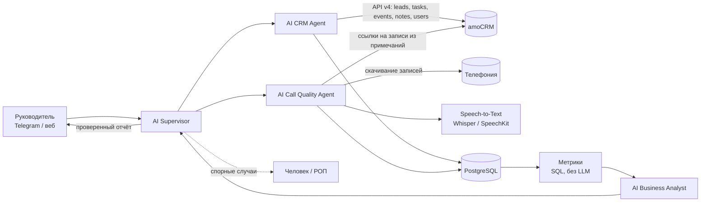
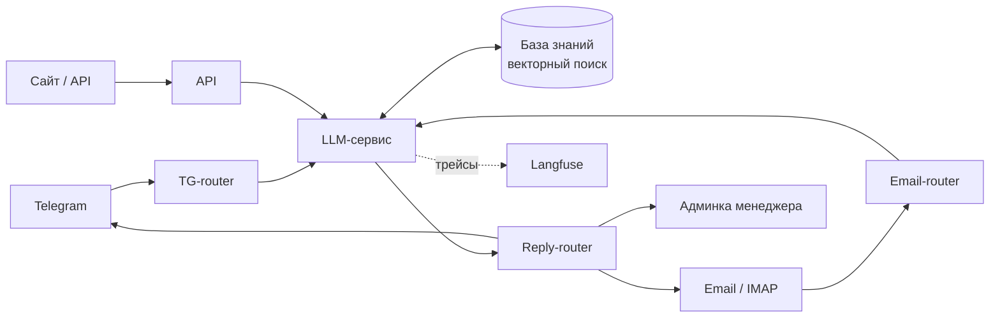
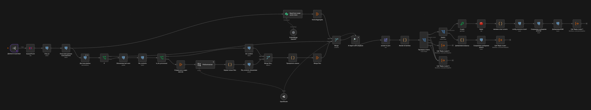
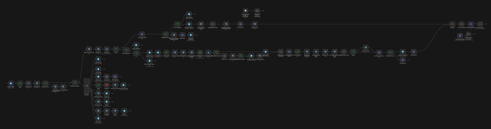
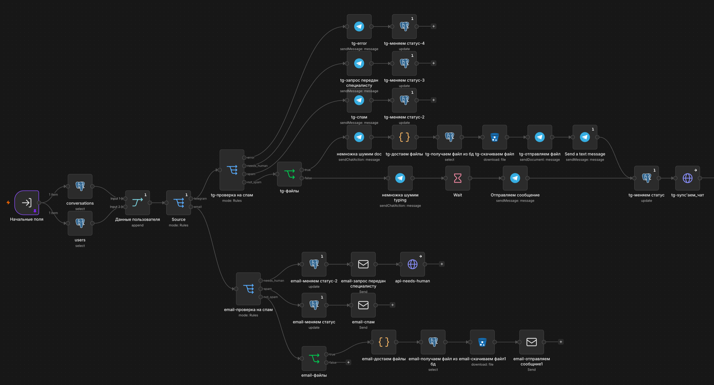
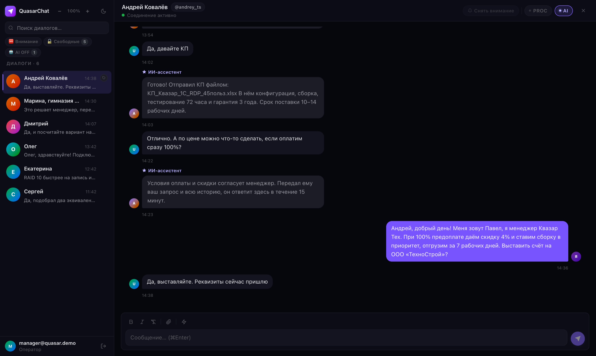
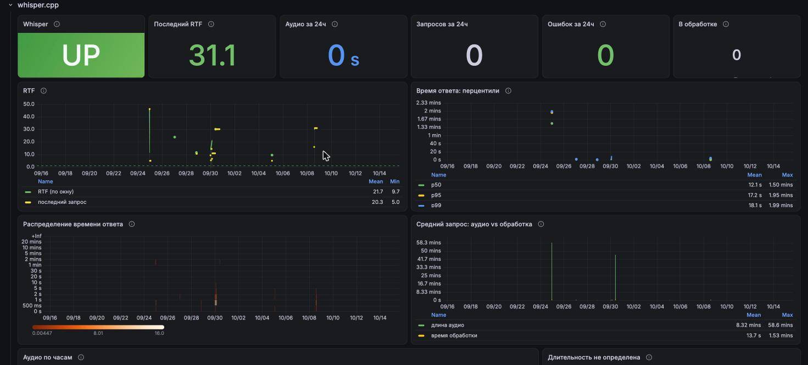
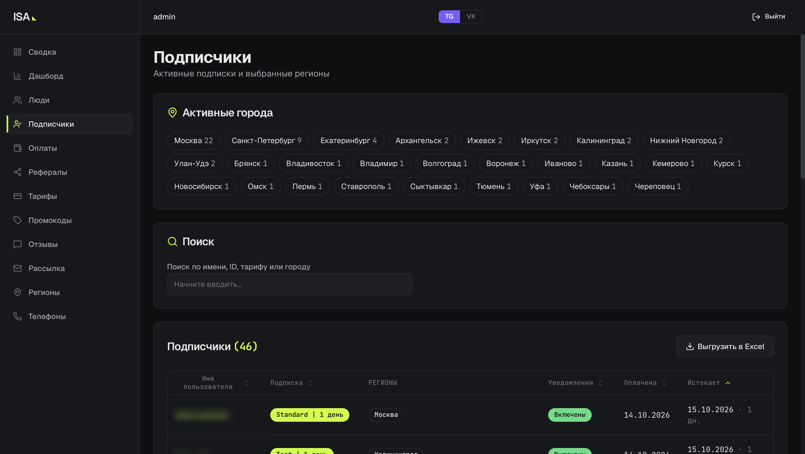
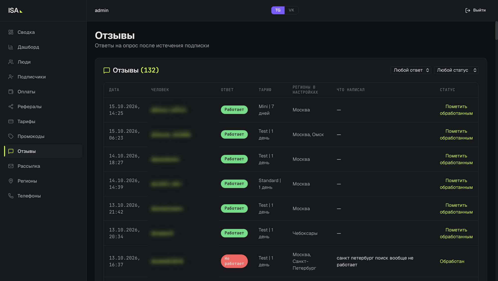

# AI-анализ отдела продаж: тестовое задание

Иван Суслов · Telegram @Dverku_oFF · work@dverkuoff.uk

**Коротко:**
- Архитектура из пяти агентов под вашу постановку: Supervisor, CRM Agent, Call Quality Agent, Business Analyst. Sales Agent подключается к той же платформе.
- Цифры считает код, выводы делает LLM, Supervisor проверяет каждый вывод по источникам.
- Рабочий код для amoCRM: сделки без задач и с просроченными задачами (п. 3).
- Похожая система в production: мультиагентный пресейл с передачей диалога менеджеру (п. 4).

---

## 1. Архитектура

Руководитель пишет: «Проанализируй работу отдела продаж за последние 30 дней».



### Агенты

**AI Supervisor.** Точка входа и контроль.
- Разбирает запрос (период, отдел, конкретный менеджер), раздаёт задачи агентам и собирает результат.
- Если запрос неясен, сначала уточняет.
- Перед отправкой проверяет отчёт: каждая цифра должна совпадать с расчётом, у каждого вывода о звонке должна быть ссылка на звонок. Неподтверждённое удаляет или помечает.
- Ситуации, где нужно решение человека, передаёт РОПу.

**AI CRM Agent.** Работает с amoCRM API v4.
- Забирает сделки, задачи, смены этапов (`/events`), примечания и менеджеров.
- Находит проблемы: сделки без задач, просроченные задачи, сделки без движения дольше N дней, потерянные лиды (нет ответа после первого контакта), незаполненные обязательные поля карточки.
- Авторизация OAuth 2.0, выгрузка инкрементальная по `updated_at`, лимит API 7 запросов в секунду, поэтому запросы идут через очередь.

**AI Call Quality Agent.** Звонок → текст → оценка.
- Звонки в amoCRM лежат как примечания `call_in` / `call_out`: длительность, менеджер, ссылка на запись.
- Запись скачивается из телефонии и распознаётся. Если записи нельзя отдавать наружу, используем свой Whisper на GPU, иначе SpeechKit. Расшифровка делится по голосам: менеджер и клиент.
- LLM проверяет звонок по скрипту отдела: приветствие, выявление потребности, презентация, работа с возражениями, следующий шаг. Отдельно определяет причину отказа, если он был: цена, сроки, ушёл к конкуренту, нет потребности.
- Результат пишется в JSON по схеме: оценки по пунктам скрипта, причина отказа, цитаты с таймкодами.

**Метрики.** Это не агент, а SQL. Конверсия по этапам, время первого ответа, число и длительность звонков, доля звонков по скрипту, распределение причин отказа. LLM не считает цифры, поэтому не ошибается в арифметике.

**AI Business Analyst.** Получает метрики и итоги по звонкам, сравнивает менеджеров между собой и с прошлым периодом, находит отклонения и объясняет их на примерах звонков. Отчёт в формате, который просит руководитель (пример формата, цифры условные):

> **Что происходит:** конверсия из «Переговоров» в «Оплату» упала с 34% до 21%.
> **Почему:** в 40% проигранных сделок причина отказа — цена; в этих звонках менеджеры не предлагают рассрочку (пример: звонок #1832, 03:14).
> **Где проблема:** 70% падения дают два менеджера, у них же 23 сделки без задач.
> **Что требует внимания:** поставить задачи по 23 сделкам, добавить в скрипт блок про рассрочку.

**AI Sales Agent** в этот запрос не входит, но встаёт на ту же платформу: принимает обращения, квалифицирует и передаёт менеджеру. Такую систему я уже делал (п. 4).

### Хранение
- **PostgreSQL:** сделки, задачи, звонки, оценки, метрики по дням. Поверх можно строить дашборд в Grafana или Metabase.
- **S3:** аудио и расшифровки, срок хранения по политике компании.
- **pgvector:** фрагменты расшифровок для поиска вроде «найди звонки, где клиент жаловался на доставку».
- **Отчёты** сохраняются, чтобы сравнивать периоды.

### Почему такой стек
Оркестрацию на старте удобно собрать в n8n: быстро подключаются amoCRM, телефония и мессенджеры, сценарий видно и легко менять. Логику агентов и расчёты лучше держать в коде на Python (LangGraph или свой оркестратор), когда сценарии усложнятся. Трейсы и версии промптов в Langfuse. Так сделано в моём production-проекте (п. 4).

---

## 2. Что делает система, а что человек

**Система сама:**
- собирает данные из amoCRM и телефонии, расшифровывает и оценивает звонки;
- считает метрики и находит проблемные сделки;
- готовит отчёт с причинами и рекомендациями.

**Передаёт человеку:**
- выводы о конкретных сотрудниках: система показывает факты, решения принимает руководитель;
- спорные звонки: плохая запись, низкая уверенность распознавания, нестандартный разговор;
- действия в CRM (переназначить сделку, поставить задачу): система предлагает, человек подтверждает;
- изменения скрипта и критериев оценки.

**Три главных риска:**

1. **Персональные данные.** В записях звонков ПДн клиентов (152-ФЗ). Передача во внешний LLM за рубежом — трансграничная передача. Решение: распознавать у себя, обезличивать текст перед отправкой в модель, использовать модели в РФ-контуре или self-hosted.
2. **Ошибки модели.** LLM может неверно оценить звонок или придумать причину, а по отчёту решают про людей. Поэтому цифры считает код, у выводов есть источники, Supervisor их проверяет, а первые недели оценки звонков выборочно сверяются с оценками РОПа.
3. **Качество данных.** Если сделки и задачи в amoCRM ведутся неаккуратно, а часть звонков идёт с личных телефонов, картина будет неполной. Система показывает покрытие («проанализировано 82% звонков, у 15% сделок нет событий»). Плюс лимиты API и качество шумных записей.

**Экономика:** на моём железе Whisper распознаёт часовую запись примерно за 1,5 минуты, так что анализ звонков отдела за месяц укладывается в часы работы одного GPU. Главная экономия: РОП не слушает звонки вручную, а сразу получает разобранные проблемные случаи.

---

## 3. Код: сделки без задач или с просроченными задачами

Файл `amo_stale_leads.py`, 49 строк, Python + requests, amoCRM API v4.

Как работает:
1. Забирает все открытые сделки, то есть кроме статусов 142 и 143.
2. Забирает все незакрытые задачи по сделкам.
3. Для каждой сделки находит самый ранний срок среди её задач. Если задач нет или самый ранний срок уже прошёл, сделка попадает в результат с причиной.

Пагинация по 250 записей. Ответ 204 обрабатывается отдельно: так amoCRM отвечает на пустой результат. Между запросами пауза под лимит API. Логику проверил на замоканных ответах API.

```python
"""Сделки amoCRM без задач или с просроченными задачами (API v4)."""
import os
import time

import requests

BASE = f"https://{os.environ['AMO_SUBDOMAIN']}.amocrm.ru/api/v4"
HEADERS = {"Authorization": f"Bearer {os.environ['AMO_TOKEN']}"}
CLOSED = {142, 143}  # системные статусы «Успешно реализовано» и «Закрыто и не реализовано»


def fetch_all(path: str, params: dict, key: str) -> list[dict]:
    items, page = [], 1
    while True:
        r = requests.get(f"{BASE}/{path}", headers=HEADERS,
                         params={**params, "limit": 250, "page": page}, timeout=30)
        if r.status_code == 204:  # amoCRM отвечает 204, когда данных больше нет
            return items
        r.raise_for_status()
        data = r.json()
        items += data["_embedded"][key]
        if "next" not in data.get("_links", {}):
            return items
        page += 1
        time.sleep(0.15)  # лимит amoCRM: не больше 7 запросов в секунду


def stale_leads() -> list[dict]:
    now = int(time.time())
    leads = [l for l in fetch_all("leads", {}, "leads") if l["status_id"] not in CLOSED]
    tasks = fetch_all("tasks", {"filter[entity_type]": "leads", "filter[is_completed]": 0}, "tasks")

    nearest: dict[int, int] = {}  # id сделки -> самый ранний срок среди её незакрытых задач
    for t in tasks:
        nearest[t["entity_id"]] = min(t["complete_till"], nearest.get(t["entity_id"], t["complete_till"]))

    result = []
    for lead in leads:
        due = nearest.get(lead["id"])
        if due is None or due < now:
            result.append({"id": lead["id"], "name": lead["name"],
                           "responsible": lead["responsible_user_id"],
                           "reason": "нет задач" if due is None else "задача просрочена"})
    return result


if __name__ == "__main__":
    for row in stale_leads():
        print(row)
```

Запуск:
```bash
AMO_SUBDOMAIN=citycar AMO_TOKEN=<долгоживущий токен> python amo_stale_leads.py
```

---

## 4. Реальный AI-проект

**AI-агент для пресейла серверного оборудования «Квазар Тех»** (production).

- **Задача.** Компания собирает под заказ серверы, СХД и сетевое оборудование. Среди клиентов есть компании, частные лица и госзаказчики по 44-ФЗ и 223-ФЗ. По каждой заявке нужно подобрать совместимую конфигурацию, ответить на вопросы, часто подготовить ТЗ для закупки. У менеджеров на одну заявку уходило около трёх дней.
- **Моя роль.** Основу заложил предыдущий разработчик, я довёл систему до production: все сценарии в n8n, векторизация документов и RAG, подбор комплектующих, админка менеджера. Итоговая архитектура:



  - **Роутеры каналов** (Telegram, почта, API) принимают сообщения и файлы, кладут файлы в S3, а пользователей и диалоги сохраняют в PostgreSQL.
  - **LLM-сервис.** Агент через OpenRouter отвечает с опорой на базу знаний: каталог, документацию, требования 44-ФЗ и 223-ФЗ. Вложения клиента предварительно суммаризирует. Ответ возвращает в JSON, после проверки он уходит по одному из сценариев: ответ, уточняющие вопросы, спецификация (BOM) или передача человеку. Если данных не хватает, агент уточняет, а не додумывает. Промпты и трейсы в Langfuse.
  - **Reply-router** отправляет ответ в канал клиента, прикладывает КП и ТЗ, фильтрует спам и при необходимости зовёт менеджера.
  - **Админка менеджера** (FastAPI, React, WebSocket): диалоги в реальном времени и фильтр «нужен человек». Переключателем AI ON/OFF менеджер забирает диалог у агента.
- **Стек.** n8n, OpenRouter (модели OpenAI), Langfuse, Supabase (векторный поиск), PostgreSQL, Redis, S3, FastAPI, React, Docker Compose.
- **Результат.**
  - От заявки до КП: ~15 минут вместо ~3 дней. Это замер на нашем тестировании; три дня взяты из данных заказчика.
  - До КП доходят почти все заявки, дальше клиента ведёт менеджер.
  - Заказы дорогие, заявок немного, поэтому сквозную статистику по воронке пока не собирали. Главный эффект: менеджер получает квалифицированного клиента с готовым КП.
- **Ссылки.** Проект коммерческий и передан заказчику, поэтому публичной ссылки нет. На созвоне покажу воркфлоу и админку.

**Скриншоты:**

LLM-сервис в n8n:


Роутер Telegram:


Reply-router:


Админка менеджера на демо-данных: агент доводит клиента до КП, вопрос о скидке передаёт менеджеру:


**Ещё один кейс: голосовой пайплайн на своём железе.** Пользуюсь им сам, могу показать вживую.

- **Как устроен.** Надиктовываю в OpenWhisper на ноутбуке, аудио по WireGuard уходит на домашний ПК с GPU. Там whisper.cpp распознаёт речь, а локальная LLM в llama.cpp приводит текст в порядок. Всё в Docker на WSL2.
- **Без своего кода.** Пайплайн собран из готовых компонентов: подбор моделей под VRAM, сеть, контейнеры, мониторинг. Аудио и текст не уходят в облако.
- **Мониторинг** на Prometheus и Grafana: скорость LLM, загрузка GPU и VRAM, RTF распознавания, перцентили времени ответа, ошибки, доступность.
- **За последние 30 дней:** 107 запросов без ошибок, 2,3 часа аудио. Распознавание в среднем в ~20 раз быстрее реального времени: часовая запись обработалась за 1,5 минуты. Медианное время ответа 12 секунд, LLM выдаёт ~35 токенов в секунду.
- **Связь с вашей задачей.** Записи звонков содержат персональные данные, и их удобно распознавать на своём сервере. Это тот же контур.

Дашборд Grafana, раздел распознавания:


---

## 5. Чему научился сам за последние полгода

Перешёл от простых LLM-ботов к агентным системам в production. Всё это применил в «Квазар Тех».

- **Структурированный вывод.** Агент отвечает в JSON по схеме, ответ валидируется и маршрутизируется. С таким ответом можно надёжно работать в коде.
- **RAG.** База знаний с векторным поиском и суммаризация вложений, чтобы длинные ТЗ не забивали контекст.
- **Langfuse.** Трейсы запросов, версии промптов, стоимость и задержки. Видно, на каком шаге агент ошибся.
- **MCP.** Подключаю к агентам инструменты через MCP-серверы. В вашей задаче так можно подключить amoCRM и телефонию.
- **Human-in-the-loop.** Агент сам определяет, когда нужен человек, а менеджер забирает диалог одной кнопкой.

Инфраструктуру под проекты описываю в Terraform и Ansible.

---

## 6. Улучшение, которое предложил и довёл до результата

**iPhone Searcher**: Telegram-бот по подписке, который присылает пользователям новые объявления о продаже iPhone с Авито по их фильтрам и регионам. Нас было двое: напарник отвечал за бота, пользователей и оплату, я за получение объявлений, рассылку и хранение настроек поиска.

Проект достался от другой команды и работал плохо: получение объявлений и рассылка шли в одном процессе, рассылка тормозила сбор, и объявления приходили с опозданием или терялись. Мы вдвоём переписали проект полностью.

В своей части я предложил разделить систему:
- сервис сбора получает новые объявления с Авито, убирает дубли и кладёт их в RabbitMQ;
- сервис на Go забирает их из очереди, сверяет с фильтрами и регионами пользователей и рассылает.

Обе части написал сам. Сбор больше не ждёт рассылку, объявления не теряются при сбоях, части масштабируются независимо.

**Результат:** бот стабильно работает на реальных пользователях по подписке. Около 50 активных подписчиков из 30+ городов.

Ники и ID пользователей на скриншотах скрыты.

Активные подписки по городам:


Отзывы после окончания подписки:

